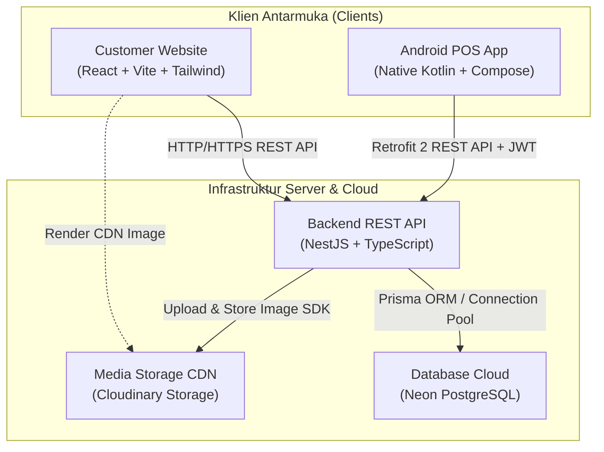

# AROMA POS – Sistem Pemesanan dan Manajemen Kuliner UMKM Terintegrasi

[](https://nestjs.com)
[](https://react.dev)
[](https://kotlinlang.org)
[](https://developer.android.com/jetpack/compose)
[](https://www.prisma.io)
[](https://www.postgresql.org)
[](https://tailwindcss.com)
[](https://cloudinary.com)

**AROMA POS** adalah sistem pemesanan mandiri dan manajemen kasir komersial terintegrasi yang dirancang khusus untuk bisnis kuliner UMKM (*AROMA – Ayam Goreng Lengkuas*). Sistem ini menghubungkan **Customer Website** untuk pemesanan mandiri pelanggan via QR meja, **Android POS** untuk operasional kasir/admin, serta **Backend NestJS REST API** dengan database **PostgreSQL Neon** sebagai sumber data terpusat (*Single Source of Truth*).

---

## 📌 1. Tentang Aplikasi

### Latar Belakang & Masalah
Usaha kuliner UMKM sering kali menghadapi kendala efisiensi operasional akibat pemesanan manual berbasis kertas, antrean panjang di meja kasir saat jam sibuk, keterlambatan informasi ke bagian dapur, serta pencatatan keuangan harian yang tidak transparan.

### Solusi & Tujuan
AROMA POS hadir untuk memberikan solusi teknologi kuliner yang modern, bersih, dan mudah digunakan:
- **Pemesanan Mandiri via QR Meja:** Pelanggan dapat melihat menu, menambah catatan khusus, dan memesan dari meja tanpa memanggil pelayan.
- **Operasional Kasir Efisien:** Kasir dapat memproses pemesanan manual (*POS*), mengonfirmasi pembayaran tunai/QRIS, memantau antrean dapur, dan mencetak/menyimpan PDF struk resmi.
- **Manajemen Menu & Laporan Terpusat:** Admin dapat mengelola kategori, mengunggah foto menu ke cloud storage, mengatur urutan produk per kategori (*custom sorting*), serta memantau surplus keuangan harian.

### Target Pengguna
- **Pelanggan Restoran:** Pengunjung restoran (*Dine In*) atau pembeli bawa pulang (*Take Away*).
- **Kasir & Admin Restoran:** Pengelola operasional harian dan pemilik restoran.

---

## ✨ 2. Fitur Utama

### 📱 Customer Website (`customer-web`) — Pelanggan
- **Akses Meja Otomatis via QR:** Mendeteksi nomor meja dari parameter URL (`?table=Meja 01`).
- **Tipe Pemesanan:** Pilihan *Dine In* (Makan di Tempat) atau *Take Away* (Bawa Pulang).
- **Katalog Menu & Kategori:** Penampilan menu berdasarkan kategori (*Makanan*, *Minuman*, *Tambahan*) dengan pengurutan presisi (*sortOrder*).
- **Sticky Category Bar:** Bar navigasi kategori yang menempel secara mulus di bawah header saat di-scroll.
- **Keranjang & Checkout:** Penambahan kuantitas, catatan khusus, dan pilihan metode pembayaran (Tunai di Kasir / QRIS).
- **Live Order Tracking:** Pemantauan status alur dapur secara *real-time* (poling 5 detik).

### 🤖 Android POS (`admin-android`) — Kasir & Admin
- **Autentikasi Keamanan:** Login kasir/admin dengan token JWT dan perlindungan rute.
- **Dashboard Omzet Harian:** Ringkasan pendapatan lunas, jumlah transaksi, dan pesanan aktif.
- **Kasir POS Manual:** Pembuatan pesanan langsung dari meja kasir dengan pilihan meja dan metode bayar.
- **Antrean Pesanan & Alur Dapur:** Pembaruan status pesanan (*Masuk Antrean* → *Sedang Dimasak* → *Siap Disajikan* → *Selesai*).
- **Manajemen Menu & Upload Foto:** Tambah/edit menu dengan pengunggahan foto dari galeri HP ke Cloud Storage (Cloudinary).
- **Penataan Urutan Produk (Custom Sorting):** Penataan posisi produk per kategori menggunakan tombol panah Naik/Turun yang langsung tersinkronisasi ke website.
- **Konfirmasi Pembayaran:** Verifikasi pembayaran Tunai dan QRIS manual.
- **Pencatatan Biaya Operasional (Expenses):** Pengelolaan data pengeluaran harian resto.
- **Laporan Keuangan & Surplus:** Rekap harian/bulanan dengan perhitungan *Surplus Operasional = Total Omzet Lunas - Pengeluaran*.
- **Cetak & Ekspor PDF Struk:** Cetak struk via Android *PrintManager* dan ekspor file PDF ke folder *Downloads*.

### ⚡ Backend REST API (`backend`) — Server
- **RESTful Endpoints:** Layanan API untuk autentikasi, produk, kategori, meja, pesanan, pembayaran, biaya, dan laporan.
- **Dual-Mode Media Storage:** Pengunggahan foto ke **Cloudinary CDN** untuk produksi, dengan *fallback* persisten lokal untuk pengembangan.
- **Database Transaction Safety:** Pengurutan produk dan transaksi pembayaran menggunakan `prisma.$transaction`.

---

## 🖼️ 3. Preview Antarmuka Aplikasi

Antarmuka AROMA POS dirancang dengan tema visual **Warm Ivory** (`#FAF8F5`), **Terracotta** (`#C94F1D`), dan **Dark Charcoal** (`#2B211D`) yang elegan dan intuitif:

- **Customer Web Header & Catalog:** Tampilan menu bersih dengan gambar resolusi tinggi dari Cloudinary CDN dan bar navigasi kategori sticky.
- **Android POS Dashboard & Cashier Order:** Layout antarmuka kasir yang nyaman digunakan pada layar sentuh ponsel Android.
- **Struk Pembayaran Digital:** Tampilan struk resmi AROMA Ayam Goreng Lengkuas beridentitas lengkap di Serang, Banten.

---

## 🏗️ 4. Arsitektur Sistem

Sistem AROMA POS mengadopsi arsitektur terpusat berbasis **Single Source of Truth**:



### Alur Kerja Data (Data Flow):
1. Admin mengubah menu atau mengurutkan produk di Android POS → Request `PATCH /api/products/reorder` dikirim ke Backend NestJS.
2. Backend NestJS memperbarui kolom `sortOrder` di database **Neon PostgreSQL** secara transaksional.
3. Pelanggan membuka Customer Website → Request `GET /api/products` mengembalikan daftar produk terurut terbaru.
4. Gambar produk dimuat secara langsung dari **Cloudinary CDN** (`https://res.cloudinary.com/...`).

---

## 🛠️ 5. Tech Stack

### Backend
- **Framework:** NestJS (Node.js v20)
- **Bahasa:** TypeScript
- **ORM:** Prisma v5
- **Autentikasi:** Passport JWT & bcrypt
- **Upload File:** Multer & Cloudinary SDK

### Android POS
- **Bahasa & SDK:** Native Kotlin (Min SDK 24 / Android 7.0+)
- **UI Framework:** Jetpack Compose & Material 3
- **Networking:** Retrofit 2 & OkHttp 4 (dengan AuthInterceptor)
- **Image Loader:** Coil Compose v2.5

### Customer Web
- **Framework:** React v18 & Vite v5
- **Styling:** Tailwind CSS v3 & Lucide Icons
- **Language:** TypeScript

### Database & Cloud Storage
- **Database:** PostgreSQL 16 (Neon Serverless PostgreSQL)
- **Object Storage:** Cloudinary CDN

### Hosting & Deployment
- **Backend Production:** SnapDeploy Container Hosting
- **Customer Web Production:** Vercel Hosting
- **Android Release:** Gradle Built APK

---

## 📁 6. Struktur Repository

```text
kuliner-msme/
├── admin-android/               # Aplikasi Native Android POS (Kotlin + Jetpack Compose)
│   ├── app/src/main/java/com/kuliner/msme/admin/
│   │   ├── data/
│   │   │   ├── api/            # RetrofitClient, ApiService, AuthInterceptor, TokenManager
│   │   │   └── model/          # Data Models (Product, Order, Category, dll)
│   │   └── ui/
│   │       ├── screens/        # Screen Composables (Products, Orders, Cashier, Reports, dll)
│   │       └── theme/          # Material 3 Color Theme (Terracotta & Warm Ivory)
│   └── build.gradle.kts
│
├── backend/                     # Backend REST API (NestJS + Prisma ORM)
│   ├── prisma/                  # Schema Prisma, Migrasi SQL, & Idempotent Seed Script
│   ├── src/                     # NestJS Modules (Auth, Products, Orders, Payments, dll)
│   ├── Dockerfile               # Multi-stage Docker Build Backend
│   └── package.json
│
├── customer-web/                # Website Pemesanan Pelanggan (React + Vite + Tailwind)
│   ├── src/
│   │   ├── components/         # Header, ProductCard, CategoryBar, OrderTrackingModal, dll
│   │   ├── api.ts              # API Client & Helper getImageUrl() Dinamis
│   │   └── App.tsx
│   ├── Dockerfile               # Multi-stage Docker Build Web (Nginx SPA)
│   └── vite.config.ts
│
├── docs/                        # Dokumentasi Proyek Lengkap
│   ├── ARCHITECTURE.md          # Penjelasan Arsitektur & Pemodelan Data
│   └── INSTALLATION.md          # Panduan Jalankan Proyek & Docker Compose
│
├── docker-compose.yml           # Orkestrasi Docker Lokal (PostgreSQL, Backend, Web)
├── logo-aroma.png               # Logo Resmi AROMA
└── README.md                    # Halaman Utama Dokumentasi Repositori
```

---

## 🚀 7. Getting Started

### Persyaratan Singkat:
- **Git**
- **Docker Desktop** (untuk menjalankan stack lokal)
- **Android Studio** (untuk aplikasi Android POS)

### Perintah Cepat Jalankan Lokal:
```bash
# 1. Clone repository
git clone https://github.com/aldxynnn/kuliner-msme.git
cd kuliner-msme

# 2. Salin environment variable
cp .env.example .env

# 3. Jalankan Docker Compose
docker compose up --build -d

# 4. Jalankan seed data master pertama kali
docker compose exec backend npm run prisma:seed
```

> 📖 **Panduan Instalasi Lengkap:**  
> Untuk panduan langkah demi langkah, koneksi pgAdmin, troubleshooting, dan cara menghubungkan Android Studio / HP Fisik, silakan buka **[Panduan Instalasi (docs/INSTALLATION.md)](docs/INSTALLATION.md)**.

---

## ⚙️ 8. Environment Configuration (`.env.example`)

Seluruh variabel lingkungan dikonfigurasi melalui file `.env`. Berikut adalah contoh variabel dan nilainya:

```env
# Database Configuration (PostgreSQL / Neon)
POSTGRES_USER=YOUR_POSTGRES_USER
POSTGRES_PASSWORD=YOUR_POSTGRES_PASSWORD
POSTGRES_DB=kuliner_db
POSTGRES_PORT=5433
DATABASE_URL="YOUR_DATABASE_URL"
DIRECT_URL="YOUR_DIRECT_URL"

# Backend Configuration
PORT=3000
JWT_SECRET=YOUR_JWT_SECRET
FRONTEND_URL=http://localhost:5173

# Cloudinary Storage Configuration (Production Cloud Storage)
CLOUDINARY_CLOUD_NAME=YOUR_CLOUDINARY_CLOUD_NAME
CLOUDINARY_API_KEY=YOUR_CLOUDINARY_API_KEY
CLOUDINARY_API_SECRET=YOUR_CLOUDINARY_API_SECRET

# Frontend Configuration (Build-time Vite API URL)
VITE_API_BASE_URL=http://localhost:3000/api
```

---

## 🗄️ 9. Database & Prisma Migration

Proyek ini menggunakan **Prisma ORM** untuk pengelolaan skema database transaksional PostgreSQL.

- **Menjalankan Migrasi Produksi (Aman untuk data):**
  ```bash
  npx prisma migrate deploy
  ```
- **Menjalankan Seed Data Master (Idempotent / Tanpa Hapus Transaksi):**
  ```bash
  npm run prisma:seed
  ```
- **Membuka Prisma Studio:**
  ```bash
  npx prisma studio
  ```

---

## 🌐 10. Deployment Architecture

| Komponen | Platform Hosting | Environment URL / Endpoint |
| :--- | :--- | :--- |
| **Backend REST API** | SnapDeploy Container | `https://aroma-backend-15717.containers.snapdeploy.app/api` |
| **Database Produksi** | Neon PostgreSQL | Cloud PostgreSQL (Pooled + Direct URL) |
| **Customer Web** | Vercel Hosting | `https://aroma-web-production.vercel.app` |
| **Android POS Release**| APK Standalone | `https://aroma-backend-15717.containers.snapdeploy.app/api/` |

---

## 📡 11. API Endpoint Overview

### Auth
- `POST /api/auth/login` – Login Kasir/Admin & Dapatkan JWT
- `GET /api/auth/me` – Profil pengguna aktif

### Products & Categories
- `GET /api/categories` – Daftar kategori menu
- `GET /api/products` – Daftar produk menu (Terurut `sortOrder asc`)
- `POST /api/products/upload` – Upload foto ke Cloudinary / local storage
- `PATCH /api/products/reorder` – Simpan urutan produk per kategori
- `POST /api/products` – Tambah produk baru
- `PUT /api/products/:id` – Edit produk
- `PATCH /api/products/:id/availability` – Toggle ketersediaan menu

### Orders & Payments
- `POST /api/orders` – Pemesanan mandiri pelanggan via QR
- `POST /api/orders/cashier` – Pemesanan manual kasir POS
- `GET /api/orders/track/:orderNumber` – Pemantauan status live pesanan
- `POST /api/payments/confirm` – Konfirmasi pembayaran kasir (Tunai / QRIS)

---

## 🛠️ 12. Troubleshooting

- **Error CORS di Website:** Pastikan backend memuat `app.enableCors({ origin: '*' })` pada `main.ts`.
- **Gambar Produk 404:** Pastikan kredensial Cloudinary telah terisi di environment backend produksi, atau jalankan skrip seed untuk memperbarui path gambar.
- **Android POS Gagal Login (404/500):** Pastikan `RetrofitClient.kt` mengarah ke `http://10.0.2.2:3000/api/` (saat uji emulator lokal) atau ke `https://aroma-backend-15717.containers.snapdeploy.app/api/` (saat uji produksi).

---

## 📜 13. Lisensi & Hak Cipta

Proyek AROMA POS dikembangkan untuk memenuhi tugas dan portofolio sistem manajemen kuliner UMKM terintegrasi. Hak cipta milik pengembang AROMA POS © 2026.
