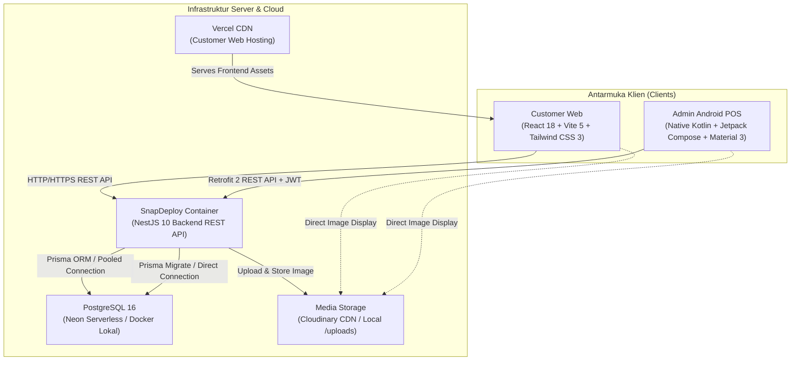
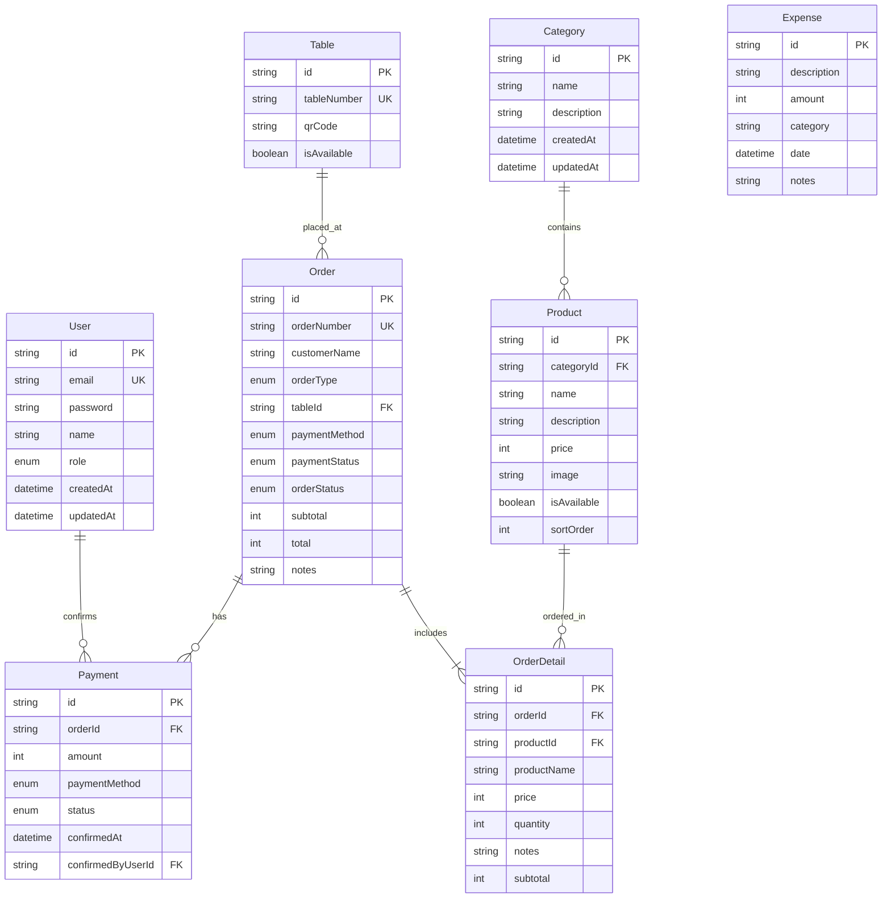

# Arsitektur Sistem AROMA POS

Dokumen ini menjelaskan arsitektur teknis, alur komunikasi data, pemodelan database, serta infrastruktur deployment untuk proyek **AROMA POS – Ayam Goreng Lengkuas**.

---

## 1. Topologi dan Diagram Arsitektur

Sistem AROMA POS mengadopsi arsitektur terpusat berbasis **Client-Server RESTful API** di mana **Customer Web** dan **Admin Android POS** berbagi satu sumber data tunggal (*Single Source of Truth*).

---

## 2. Alur Komunikasi & Sinkronisasi Data

### A. Alur Pemesanan Mandiri Pelanggan (`customer-web`)
1. Pelanggan memindai QR Code di meja yang membuka Customer Web dengan parameter `?table=Meja 01` (atau memilih *Dine In* / *Take Away* secara langsung).
2. Customer Web mengambil kategori dan menu melalui `GET /api/categories` dan `GET /api/products` (terurut `sortOrder asc`).
3. Gambar produk dirender melalui helper `getImageUrl()` yang mendukung URL absolut Cloudinary CDN maupun path relatif `/uploads/...` saat lokal.
4. Saat checkout, pesanan dikirim ke `POST /api/orders` dan tersimpan dengan status awal `MENUNGGU_PEMBAYARAN` serta nomor pesanan unik yang disimpan pada `localStorage` (`kuliner_active_order_number`).
5. Customer Web melakukan polling setiap 5 detik ke `GET /api/orders/track/:orderNumber` untuk memperbarui status pesanan dan pembayaran secara otomatis.

### B. Alur Operasional Kasir & Admin (`admin-android`)
1. Kasir/Admin masuk melalui `POST /api/auth/login`. Token JWT disimpan di `TokenManager` (`SharedPreferences`) dan disisipkan otomatis oleh `AuthInterceptor` pada header `Authorization: Bearer <token>`.
2. Setelah login, `OrderMonitorService` dan `NotificationCenter` memantau pesanan masuk serta menampilkan notifikasi sistem dan badge in-app.
3. Kasir dapat membuat pesanan manual (`POST /api/orders/cashier`), memverifikasi pembayaran (`POST /api/payments/confirm`), memproses tahapan dapur (`PATCH /api/orders/:id/status`), dan mencetak/menyimpan PDF struk (`GET /api/orders/:id/receipt`).
4. Pengelola dapat mengatur katalog menu, mengunggah foto produk (`POST /api/products/upload`), mengubah ketersediaan (`PATCH /api/products/:id/availability`), serta menata urutan produk per kategori (`PATCH /api/products/reorder` menggunakan `prisma.$transaction`). Perubahan langsung tampil di Customer Web.

---

## 3. Pemodelan Database (`backend/prisma/schema.prisma`)

---

## 4. Keamanan & Validasi
- **JWT Stateless Authentication:** Seluruh endpoint mutasi data master, kasir, pembayaran, pengeluaran, dan laporan dilindungi oleh `JwtAuthGuard`.
- **Password Hashing:** Kata sandi di-hash menggunakan `bcrypt` (10 *salt rounds*).
- **Global Input Validation:** `ValidationPipe` (`whitelist: true`, `transform: true`) memvalidasi setiap request body pada backend NestJS.
- **Isolasi Kredensial:** File `.env` diabaikan oleh `.gitignore` sehingga rahasia seperti `DATABASE_URL`, `JWT_SECRET`, dan kredensial Cloudinary tidak masuk ke repository Git.
