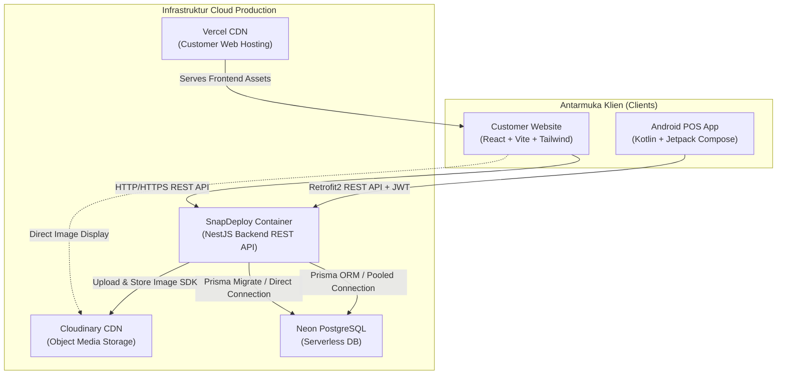
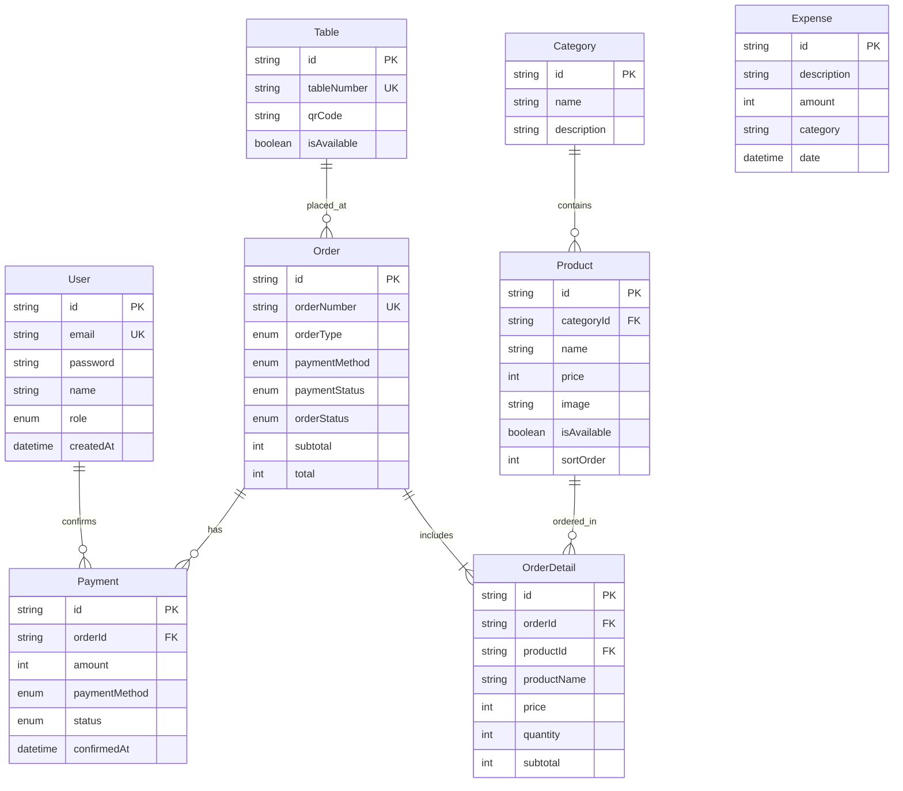

# Arsitektur Sistem AROMA POS

Dokumen ini menjelaskan arsitektur teknis, alur komunikasi data, pemodelan database, serta infrastruktur deployment untuk proyek **AROMA POS & Customer Website**.

---

## 1. Topologi dan Diagram Arsitektur

Sistem AROMA POS mengadopsi arsitektur terpusat berbasis **Client-Server RESTful API** di mana seluruh antarmuka (*Customer Website* dan *Android POS*) berbagi satu sumber data tunggal (*Single Source of Truth*).

---

## 2. Alur Komunikasi & Sinkronisasi Data (Data Flow)

### A. Alur Pemesanan Mandiri Pelanggan (Customer Ordering Flow)
1. Pelanggan memindai QR Code di meja yang membawa parameter `?table=Meja 01`.
2. Customer Web mengirimkan permintaan `GET /api/categories` dan `GET /api/products` ke Backend NestJS.
3. Backend membaca data terurut (`sortOrder asc`) dari database PostgreSQL via Prisma ORM dan mengembalikan respons JSON.
4. Gambar produk dirender secara dinamis via helper `getImageUrl()` mengarah ke Cloudinary CDN (`https://res.cloudinary.com/...`).
5. Pelanggan mengirimkan pesanan baru via `POST /api/orders`. Backend mencatat transaksi dengan status awal `MENUNGGU_PEMBAYARAN` atau `MENUNGGU_DIPROSES`.
6. Poling status live pesanan (`GET /api/orders/track/:orderNumber`) memperbarui tampilan pelanggan setiap 5 detik.

### B. Alur Manajemen & Operasional Kasir (Android POS Flow)
1. Kasir/Admin membuka aplikasi Android dan melakukan login via `POST /api/auth/login`. Token JWT disimpan aman di `TokenManager` (SharedPreferences).
2. `AuthInterceptor` secara otomatis menyisipkan header `Authorization: Bearer <token>` pada setiap *request* terlindungi.
3. Kasir dapat melakukan penataan urutan produk (*custom sorting per category*). Saat kasir menekan "Simpan Urutan", Android POS mengirimkan `PATCH /api/products/reorder`.
4. Backend memperbarui kolom `sortOrder` secara transaksional (`prisma.$transaction`).
5. Perubahan urutan langsung terefleksi secara *real-time* di Customer Website tanpa perlu melakukan migrasi atau pengubahan struktur data.

---

## 3. Pemodelan Database (Prisma Schema Relational Model)

---

## 4. Keamanan & Model Otentikasi
- **JWT (JSON Web Token):** Menggunakan otentikasi stateless dengan umur token terkonfigurasi. Rute yang mengubah data master (kategori, produk, meja, biaya) dilindungi oleh `JwtAuthGuard`.
- **Enkripsi Sandi:** Kata sandi pengguna di-hash menggunakan algoritma `bcrypt` dengan 10 *salt rounds*.
- **Perlindungan Kredensial:** Variabel lingkungan sensitif (`JWT_SECRET`, `DATABASE_URL`, `CLOUDINARY_API_SECRET`) tidak pernah disertakan dalam repositori Git atau kode klien Android.
